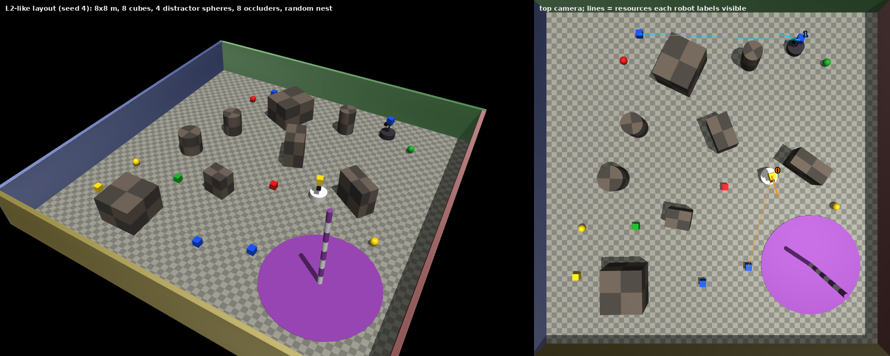
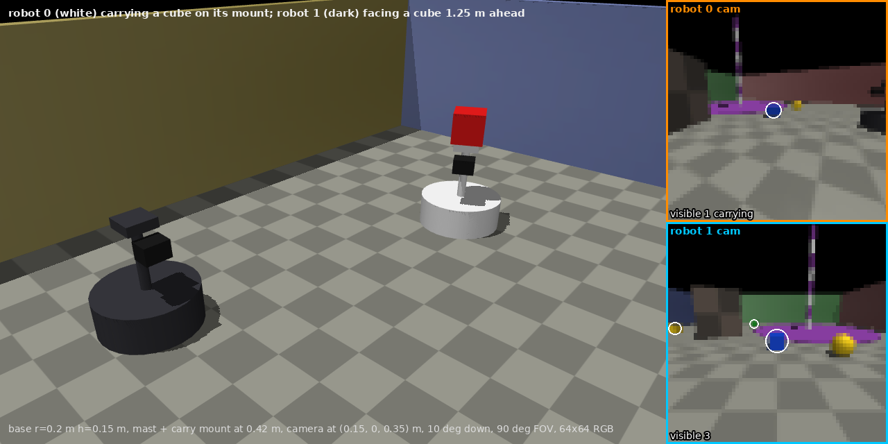
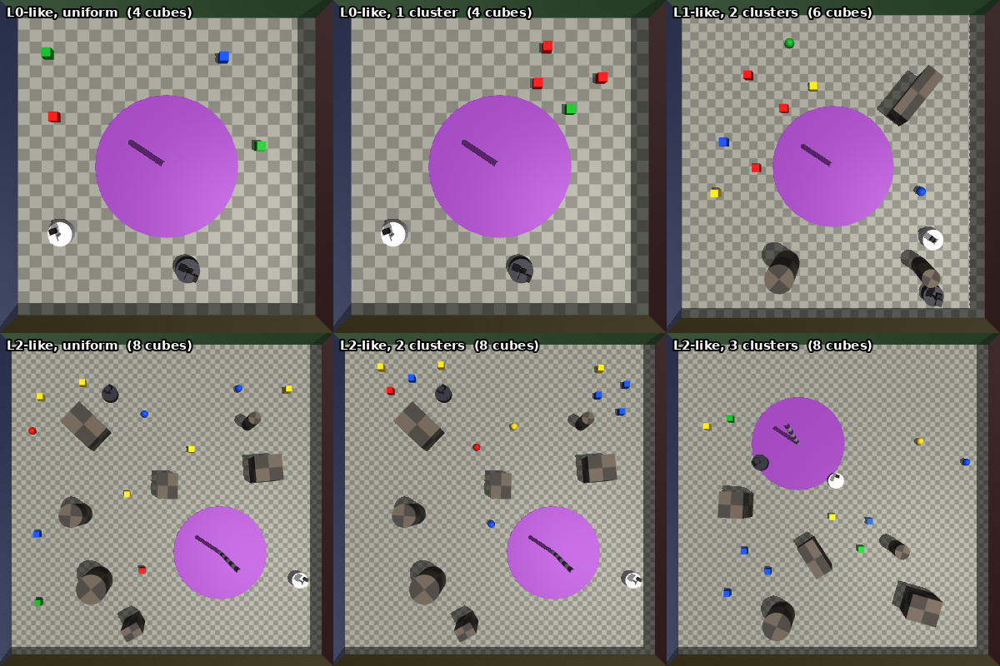
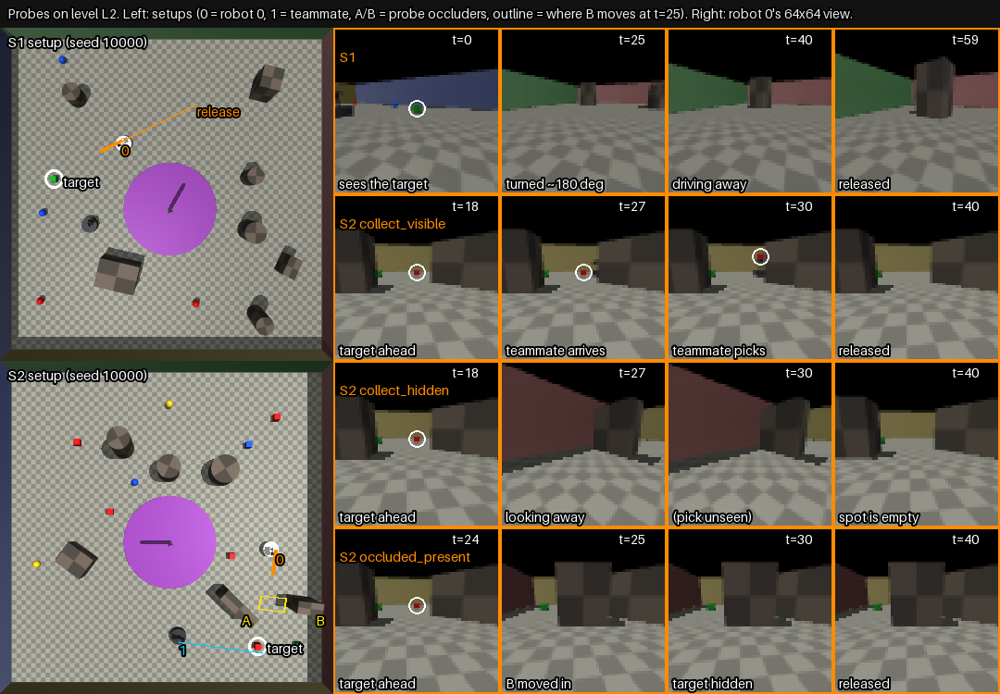
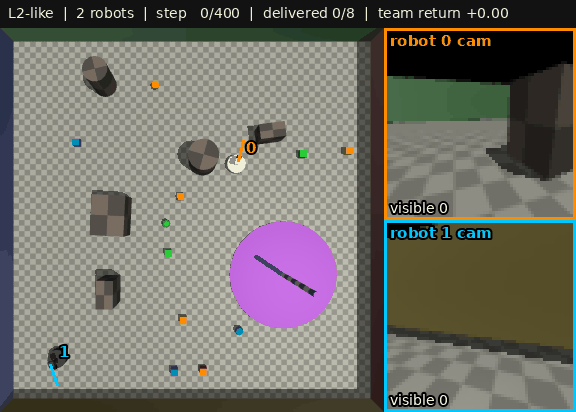

# Foraging Environment

**Multi-robot visual foraging in MuJoCo.** A team of 1–4 wheeled robots must find coloured cubes in
a cluttered arena and carry them to a nest. Each robot sees only a 64×64 RGB image from its own
forward-facing camera. Occluders hide cubes, look-alike spheres act as distractors, and teammates
take cubes away out of sight. To act well, a robot has to remember what it has seen and notice
what has changed since.

Alongside the images, the environment returns per-robot ground truth about every cube (whether it
exists, is still available, is visible right now, has ever been seen, and where it is relative to
the robot) for supervising or probing what a policy believes about the world. It also returns a
privileged global state for centralized critics, and scripted probe episodes that test memory.


*An 8×8 m layout (level L2) with 8 cubes, 4 distractor spheres, 8 occluders and the nest (purple
disc with a striped pole). Right: top-down view; lines link each robot to the cubes it can see.*

## Contents

- [Highlights](#highlights)
- [Installation](#installation)
- [Quick start](#quick-start)
- [Task specification](#task-specification): [formal model](#formal-model), [world](#world),
  [actions](#action-space), [observations](#observation-space), [reward](#reward-function),
  [episode end](#termination-and-truncation)
- [Privileged information](#privileged-information): [state](#privileged-state-priv_state),
  [labels](#ground-truth-labels-labels), [what a policy may use](#what-a-learned-policy-may-use)
- [Configuration](#configuration) and [curriculum levels](#curriculum-levels)
- [Layouts, seeds and evaluation protocol](#layouts-seeds-and-evaluation-protocol)
- [Probe scenarios](#probe-scenarios)
- [Scripted agents and baselines](#scripted-agents-and-baselines)
- [Vectorized environment](#vectorized-environment)
- [Task metrics](#task-metrics)
- [Reading state and rendering other views](#reading-state-and-rendering-other-views)
- [Performance and determinism](#performance-and-determinism)
- [Known limitations](#known-limitations)
- [Repository layout](#repository-layout), [tests](#tests), [troubleshooting](#troubleshooting)

## Highlights

- **Egocentric pixels only.** A policy observes one 64×64 RGB frame per robot (90° field of view,
  0.35 m above the floor), its previous action and a carry flag. No positions, no maps.
- **Partial observability by design.** Occluders taller than the cameras, a 90° field of view,
  distractor spheres that share the cubes' colours (only shape tells them apart), and teammates
  that remove cubes.
- **Ground-truth belief labels** per robot and cube: `exists`, `available`, `carried_by`,
  `visible`, `ever_seen`, `bearing`, `distance`, for auxiliary losses and probing.
- **Privileged state** for centralized training with decentralized execution (CTDE).
- **Curriculum** of three levels (`L0` → `L2`), procedurally generated layouts, and a fixed
  split into 10,000 training and 200 held-out layout seeds.
- **Probe scenarios** (persistence, ambiguity, full task) with scripted prefixes and controlled
  interventions, and scripted **baselines** (random, heuristic forager) with reference numbers.
- **Fast and reproducible.** A shared-memory vector env reaches about 10–15k agent frames/s on
  one desktop GPU; states, rewards and labels are bit-exact for equal seeds and actions.

## Installation

Requires Python ≥ 3.10, MuJoCo ≥ 3.2 and NumPy; developed with Python 3.11 and MuJoCo 3.16–3.17
(the pinned `requirements.txt` needs Python ≥ 3.11). Linux is the primary platform (headless GPU
rendering through EGL); macOS and Windows work with a display.

```bash
git clone <repository-url> foraging-env && cd foraging-env
conda create -n foraging python=3.11 -y && conda activate foraging   # or: python3.11 -m venv .venv && source .venv/bin/activate
pip install -r requirements.txt    # pinned, tested versions: mujoco, numpy, pillow, imageio, pytest
pip install -e .                   # the foraging_env package
```

`pip install -e .` alone installs only the core dependencies (`mujoco`, `numpy`);
`pip install -e ".[viz,dev]"` adds Pillow, imageio and pytest with loose version bounds.

### Headless rendering on Linux

MuJoCo chooses its OpenGL backend from the `MUJOCO_GL` environment variable, which it reads when
it is first imported. If `MUJOCO_GL` is unset, `import foraging_env` sets it to `egl` on Linux,
so import `foraging_env` before `mujoco` (or set the variable in the shell).

| machine | backend | system packages (Debian/Ubuntu) | setting |
|---|---|---|---|
| NVIDIA GPU, no display (servers, clusters) | EGL | the NVIDIA driver and `libegl1` | default (`MUJOCO_GL=egl`) |
| no GPU | OSMesa (software, slower) | `libosmesa6-dev` | `MUJOCO_GL=osmesa` |
| desktop with a display | GLFW | none | `MUJOCO_GL=glfw` |
| no OpenGL at all | none | none | `{"render": False}`: no GL context is created and `obs["rgb"]` is `None` |

On macOS and Windows MuJoCo's default backend (GLFW) is used. Check the installation with:

```bash
python examples/random_agents.py --episodes 1                   # renders: tests your OpenGL setup
python examples/random_agents.py --episodes 1 --no-render       # no OpenGL needed
python -m pytest -q                                             # full test suite, ~1 min
```

See [Troubleshooting](#troubleshooting) for EGL in Docker, choosing a GPU, and common errors.

## Quick start

```python
import numpy as np
from foraging_env import ForagingEnv, HELDOUT_SEEDS, N_ACTIONS

rng = np.random.default_rng(0)
with ForagingEnv({"level": "L2", "n_robots": 2}, seed=0) as env:      # cfg overrides, env seed
    obs, info = env.reset(layout_seed=HELDOUT_SEEDS[0])
    print(obs["rgb"].shape)                                           # (2, 64, 64, 3)
    done = False
    while not done:
        actions = rng.integers(N_ACTIONS, size=env.n)                 # one action per robot
        obs, reward, done, info = env.step(actions)                   # reward: float32[2]
    print(info["t"], info["truncated"], env.deposited.sum())          # 400 True 0
```

`step` returns `(obs, reward, done, info)`. `done` covers both the end of the task and the time
limit; `info["truncated"]` tells them apart. Use the env as a context manager or call
`env.close()` to release its GL context.

[`examples/random_agents.py`](examples/random_agents.py) runs this loop end to end and prints the
spaces, one line per episode, and optionally a GIF or the vectorized version:

```text
$ python examples/random_agents.py --level L2 --gif runs/random_L2.gif
level L2: 8 x 8 m arena, 2 robots, 6 cubes, 3 distractor spheres, 6 occluders; at most 400 steps at 10 Hz
action space, per robot: Discrete(7) = 0 noop, 1 forward, 2 backward, 3 turn_left, 4 turn_right, 5 pick, 6 deposit
observation (policy input), one row per robot:
  obs['rgb']                      uint8[2, 64, 64, 3]
  obs['prev_action']              int64[2]
  obs['carrying']                 bool[2]
info (privileged: critic input, training targets, metrics; not policy input):
  info['priv_state']              float32[60]
  info['labels'][i]['exists']     bool[8]   (one entry per cube slot)
  ...
  info['labels'][i]['distance']   float32[8]   (one entry per cube slot)
  info['events']                  list of (kind, robot, cube, t), kind 'pick' or 'deposit'

wrote runs/random_L2.gif (201 frames)
episode 0 | layout 10000 | 400 steps (time limit) | delivered 0/6 | picks 0 | team return -0.400 | 198 steps/s
episode 1 | layout 10001 | 400 steps (time limit) | delivered 0/7 | picks 0 | team return -0.400 | 1,507 steps/s
episode 2 | layout 10002 | 400 steps (time limit) | delivered 0/8 | picks 0 | team return -0.400 | 1,347 steps/s
```

Other options: `--robots 4`, `--episodes N`, `--max-steps T`, `--no-render`, and `--n-envs K` to
run `VectorForagingEnv` with K envs in worker processes.

To watch random agents live, [`examples/live_viewer.py`](examples/live_viewer.py) opens MuJoCo's
interactive viewer and steps the env in real time, 10 steps per second. It needs a display; on
macOS run it with `mjpython`. In the viewer, `]` and `[` cycle through the top-down and robot
cameras.

```bash
python examples/live_viewer.py
```

## Task specification

### Formal model

The task is a partially observable stochastic game with a mostly shared reward:

| element | definition |
|---|---|
| agents | $N$ = 1–4 homogeneous robots (`n_robots`, default 2) |
| state | the MuJoCo state (robot poses and velocities), each cube's status (in the episode, carried by whom, deposited) and position, the static layout (arena, occluders, spheres, nest, lighting), and the step count |
| initial state | a layout drawn by `sample_layout(cfg, rng(layout_seed))` ([details](#how-a-layout-is-sampled)); robots start at rest, not carrying |
| actions | $\mathcal{A}_i$ = {0, …, 6} per robot, chosen simultaneously ([table](#action-space)) |
| observations | $o_t^i$ = (64×64 RGB from robot $i$'s camera, robot $i$'s previous action, robot $i$'s carry flag) |
| transitions | deterministic MuJoCo physics (10 substeps of 10 ms per step); the only randomness inside an episode is the order in which simultaneous `pick`/`deposit` actions are resolved (a uniformly random permutation of the robots, drawn from the env seed) |
| reward | $r_t^i$, per robot: a team reward per deposit, a small individual pick bonus, a step penalty ([details](#reward-function)) |
| horizon | $H$ = 400 steps (40 s) or until every cube is deposited; the discount factor is the learner's choice |

With the rewards averaged over robots (as a centralized critic usually does), it is a Dec-POMDP.

### World

| element | specification |
|---|---|
| arena | square, `arena_size` m per side (5, 6 or 8 m by level), centred at the origin, checkered floor. Walls are 1 m tall; each has a different colour gradient (reddish +x, greenish +y, bluish −x, yellowish −y), so sides can be told apart. |
| robots | cylinders, radius 0.2 m, height 0.15 m, 5 kg, with a mast and a carry mount at 0.42 m and one camera. Colours: white, dark grey, brown, teal (robots 0–3). |
| cubes (resources) | edge 0.15 m, coloured red, green, blue or yellow; up to 8 per episode (`R_MAX`). |
| spheres (distractors) | diameter 0.18 m, same four colours, so only shape tells them from cubes. Cannot be picked up. Up to 4 per episode (`D_MAX`). |
| occluders | boxes (half-extents 0.15–0.5 m) or cylinders (radius 0.15–0.35 m), 0.5–0.9 m tall, so always taller than a camera. Block both sight and movement. |
| nest | purple disc, radius 1.2 m, with a 2 m striped pole visible from across the arena. Deposited cubes are placed on a ring of 8 slots (radius 0.45 m) around the pole. |
| lighting | one directional light (direction (−0.3, 0.2, −1), diffuse 0.6) with shadows, plus a headlight; direction and intensity are randomised per episode in L2. |

**Collisions.** Robots collide with walls, occluders, the pole, each other, and the cubes and
spheres on the floor. Cubes, spheres, occluders, walls and the nest are kinematic: robots bump
into them but cannot push them. A cube stops colliding once it is picked up. Robots drive over
the nest disc. There is no floor contact or friction: the base moves on planar joints (slide x,
slide y, hinge z).

Fixed quantities (sizes, camera placement, colours, padding) are in
[`foraging_env/constants.py`](foraging_env/constants.py).


*Robot 0 (white) carries a cube on its mount; robot 1 (dark) faces a cube 1.25 m ahead. Right:
their 64×64 camera images, upscaled. White rings mark cubes labelled visible.*

### Action space

All robots act at the same time, at 10 Hz on top of 100 Hz physics. Each robot chooses one of 7
discrete actions per step (0.1 s):

| id | name | effect |
|---|---|---|
| 0 | `noop` | stop |
| 1 | `forward` | drive along the heading at 0.6 m/s (0.06 m per step) |
| 2 | `backward` | reverse at 0.6 m/s |
| 3 | `turn_left` | turn in place at 90°/s, counter-clockwise (9° per step) |
| 4 | `turn_right` | turn in place at 90°/s, clockwise |
| 5 | `pick` | if not carrying: pick up the nearest available cube within reach (below) |
| 6 | `deposit` | if carrying and the robot's centre is inside the nest disc: place the cube on the nest |

- **Dynamics.** Each robot has velocity actuators on its x, y and yaw joints, with gains equal to
  mass (or yaw inertia) over the physics timestep and force caps of 150 N and 3 N·m. At the start
  of a step the targets are set to $(v\cos\psi, v\sin\psi)$ for `forward`/`backward` (with $\psi$
  the current heading) or ±90°/s for the turns, and to zero for the other actions; they
  are held for the 10 physics substeps (MuJoCo's `implicitfast` integrator, 10 ms each). Starting
  from rest, the first step covers 0.057 m or 7°.
- **Pick.** Robot $i$ picks cube $r$ if it is not carrying, $r$ is available (in the episode, not
  carried, not deposited), the planar distance from the robot's centre to the cube's centre is at
  most `pick_range` = 0.35 m, and the cube's bearing is within ±`pick_half_angle_deg` = ±30° of
  the heading. Of several such cubes it takes the nearest. Since a robot's radius plus a cube's
  half-edge is 0.275 m, the robot must be nearly touching the cube.
- **Deposit.** Robot $i$ deposits its cube if it is carrying and its centre is within 1.2 m of the
  nest centre, facing any way. The cube is placed on the next free pile slot.
- **Resolution.** Picks and deposits are resolved after the physics step, robot by robot in a
  random order (from the env seed): if two robots pick the same cube in the same step, either may
  get it. A carried cube then rides on its robot's mount. A `pick` or `deposit` that doesn't
  apply does nothing; the env provides no action masks, since a mask would reveal privileged
  information (for example, that a cube is within reach).
- The ids are exported as `NOOP`, `FORWARD`, `BACKWARD`, `TURN_LEFT`, `TURN_RIGHT`, `PICK` and
  `DEPOSIT`, along with `N_ACTIONS` and `ACTION_NAMES`.

### Observation space

`obs` is a dict of arrays with one row per robot ($N$ robots), rendered after the step's physics,
picks and deposits:

| key | dtype, shape | content |
|---|---|---|
| `rgb` | `uint8 [N, 64, 64, 3]` | each robot's camera image, row 0 at the top; `None` when `render=False` |
| `prev_action` | `int64 [N]` | the action each robot took on the previous step (`noop` after reset); one-hot encode it yourself |
| `carrying` | `bool [N]` | whether the robot is holding a cube |

**Camera model.** A pinhole camera 0.15 m ahead of the robot's centre at a height of 0.35 m,
pitched 10° down, with a 90° field of view both horizontally and vertically (square images).
For an image of side $S$ (`img_size`, default 64) the focal length is $S/2$ pixels (32 px at 64×64)
and the principal point is the image centre. The near plane is at 1 cm. Only scene geometry is
drawn (MuJoCo geom group 0, no sites or debug markers), with shadows from a 1024² shadow map and
MuJoCo's default 4× multisampling. A cube 1 m ahead of a robot covers about 6×7 pixels at 64×64.

### Reward function

`reward` is `float32 [N]`, one value per robot. With $D_t$ the number of deposits (by any robot)
in step $t$:

$$r_t^i = -c_\text{step} + c_\text{pick}\,\mathbf{1}[i \text{ picks at } t] + c_\text{dep}\,D_t + \mathbf{1}[\text{shaping on}]\;\mathbf{1}[i \text{ was not carrying}]\;c_\text{shape}\left(d^i_{t-1} - d^i_t\right)$$

| term | default | received by |
|---|---|---|
| step penalty $c_\text{step}$ | 0.001 | every robot, every step |
| pick bonus $c_\text{pick}$ | 0.2 | the robot that picks |
| deposit reward $c_\text{dep}$ | 1.0 per cube | every robot (team reward) |
| dense shaping $c_\text{shape}$ (off by default, on in L0) | 0.01 per metre | each robot that was not carrying at the start of the step |

$d^i$ is the planar distance from robot $i$'s centre to the nearest cube that was available at
the start of the step, measured to the cubes' positions at the start of the step, so only the
robot's own motion counts. In an episode in which every cube is delivered, each robot's
undiscounted return is $c_\text{dep} \cdot n_\text{cubes}$, plus $c_\text{pick}$ per cube it
picked, minus $c_\text{step}$ per step (plus shaping, if on).

### Termination and truncation

`done` is `True` once every cube in the episode has been deposited, or when `t == max_steps`
(400). `info["truncated"]` is `True` only in the second case, when a value function should
bootstrap.

### Coordinates and units

World frame: origin at the arena centre, z up, metres; yaw in radians, counter-clockwise from +x.
Robot frame: x ahead, y to the left. Box and cylinder sizes follow MuJoCo's half-size convention.

## Privileged information

`info` holds everything a policy must not see but training and evaluation code need:

| key | content |
|---|---|
| `priv_state` | `float32 [D]`: compact global state for a centralized critic |
| `labels` | list of $N$ dicts: per-robot ground truth about every cube slot |
| `events` | `(kind, robot, cube, t)` tuples for this step, with `kind` either `"pick"` or `"deposit"` |
| `t` | steps taken this episode |
| `layout_seed` | seed of this episode's layout (`None` for an explicit layout) |
| `truncated` | the episode ended at the time limit |

### Privileged state (`priv_state`)

$D = 5N + 8(4 + N) + 2$, i.e. 47, 60, 73 and 86 for 1–4 robots. The vector concatenates:

| indices | per | values |
|---|---|---|
| $[5j, 5j + 5)$ | robot $j$ | $x, y, \cos\psi, \sin\psi$, carrying (0/1) |
| $5N + r(4 + N) + [0, 4 + N)$ | cube slot $r$ (8 slots) | $x, y$, available, deposited, one-hot of the robot carrying it ($N$ values); all zeros for unused slots |
| $[D - 2, D)$ | nest | $x, y$ |

A carried cube's position is its robot's; a deposited cube's is its pile slot. `priv_state`
leaves out velocities and the static layout (walls, occluders, spheres), which a critic conditioned
on it cannot see.

`priv_state_ego_index(N)` returns an `int64 [N, D]` index: `priv_state[..., idx[i]]` is the same
state as robot `i` sees it, with robot `i`'s block first, the others after it in order, and each
cube's carried-by one-hot reordered the same way. It equals the `priv_state` of the same scene
with the robots renumbered, which lets a policy shared by all robots, with no agent id, read the
privileged state from its own robot's side (for privileged upper-bound baselines).

### Ground-truth labels (`labels`)

`info["labels"][i]` describes the world from robot `i`'s point of view as a dict of arrays with
8 entries, one per cube slot. Slots beyond this episode's cube count have `exists=False`.

| key | dtype | meaning |
|---|---|---|
| `exists` | bool | the slot holds a cube this episode |
| `available` | bool | exists, not carried, not deposited |
| `carried_by` | int8 | id of the robot carrying it, or −1 |
| `visible` | bool | robot `i` can see it now (below) |
| `ever_seen` | bool | robot `i` has seen it at some step of this episode (`visible` OR-ed over time) |
| `bearing` | float32 | direction from robot `i`'s centre, radians in the robot's frame (0 ahead, positive to the left) |
| `distance` | float32 | planar distance from robot `i`'s centre, metres |

`exists`, `available` and `carried_by` are the same for every robot. `bearing` and `distance` are
filled in for every existing cube, visible or not (they are targets, not detections), and are 0
for unused slots.

**Visibility.** With $c_i$ the camera position, $R_i$ its orientation and
$(x, y, z)^\top = R_i^\top (p_r - c_i)$ the cube centre in the camera frame (MuJoCo: x right,
y up, looking along −z), cube $r$ is `visible` to robot $i$ when

$$z < 0, \qquad |x| \le -z \tan 45^\circ, \qquad |y| \le -z \tan 45^\circ, \qquad \lVert p_r - c_i \rVert < d_\text{max},$$

with $d_\text{max}$ = `fov_range` (6 m), and a ray from $c_i$ to $p_r$ against the rendered geometry (robot $i$'s own body excluded) hits
cube $r$ first. Anything else in the scene blocks it: other robots and the cubes they carry,
occluders, walls, the nest pole, other cubes and spheres. See
[Known limitations](#known-limitations) for what the centre-only test implies.

### What a learned policy may use

A learned policy should see only its own robot's `obs` entries (RGB, previous action, carry
flag). `info["priv_state"]` is for centralized critics, `info["labels"]` for auxiliary losses and
metrics, and the env's state accessors (`robot_poses()`, `resource_positions()`, `layout`, ...)
for scripted agents and tools. None of it should reach a learned policy, directly or through
action masking, unless the policy is explicitly a privileged baseline.

## Configuration

`ForagingEnv(cfg, seed)` merges `cfg` over `DEFAULT_CFG`. Unknown keys raise `ValueError`, so a
typo can't be silently ignored. Count keys accept an int or an inclusive `[lo, hi]` range, from
which each episode samples a value. `resolve_cfg(cfg)` returns the full config the env will use
(the same dict as `env.cfg`).

| key | default | meaning |
|---|---|---|
| `level` | None | a curriculum preset, `"L0"`, `"L1"` or `"L2"` ([levels](#curriculum-levels)) |
| **layout** | | |
| `n_robots` | 2 | team size, 1–4 |
| `arena_size` | 5.0 | side length of the square arena (m) |
| `n_resources` | 4 | cubes per episode, at most 8 |
| `n_distractors` | 0 | spheres per episode, at most 4 |
| `n_occluders` | 0 | occluders per episode |
| `nest` | `"center"` | `"center"` or `"random"` |
| `resource_clusters` | 0 | 0 places cubes uniformly; k groups them into k clusters |
| `cluster_radius` | 1.0 | maximum distance from a cube to its cluster centre (m) |
| `near_occluder_frac` | 0.0 | fraction of cubes placed close to an occluder, where they are easily hidden |
| `near_occluder_dist` | 1.0 | "close": distance from the cube's centre to the occluder's footprint (m) |
| `light_dir` | (−0.3, 0.2, −1.0) | direction of the directional light |
| `light_diffuse` | (0.6, 0.6, 0.6) | its diffuse colour |
| `light_azimuth_jitter_deg` | 0.0 | per episode, rotate `light_dir` about the vertical by up to ± this angle |
| `light_intensity_jitter` | 0.0 | per episode, scale `light_diffuse` by a factor in [1 − j, 1 + j] |
| **dynamics** | | |
| `substeps` | 10 | physics steps (10 ms each) per env step |
| `v_forward`, `v_backward` | 0.6, 0.6 | drive speeds (m/s) |
| `turn_rate_deg` | 90.0 | turn rate (°/s) |
| `pick_range` | 0.35 | maximum distance from robot centre to cube centre for `pick` (m) |
| `pick_half_angle_deg` | 30.0 | maximum absolute bearing of the cube for `pick` (°) |
| **episode and reward** | | |
| `max_steps` | 400 | time limit |
| `deposit_reward` | 1.0 | team reward per deposit |
| `pick_reward` | 0.2 | individual reward per pick |
| `step_penalty` | 0.001 | subtracted from every robot each step |
| `dense_shaping` | False | adds the distance-based shaping term |
| `shaping_coef` | 0.01 | its coefficient |
| **rendering and labels** | | |
| `render` | True | render camera images; with `False`, `obs["rgb"]` is `None` and no GL context is created |
| `img_size` | 64 | image side (px) |
| `shadows` | True | directional-light shadows |
| `fov_range` | 6.0 | maximum camera-to-cube distance for `visible` (m) |
| `model_cache_size` | 8 | compiled models kept per env ([model caching](#model-caching)) |

### Curriculum levels

The `level` key selects one of three presets, from an open room to a cluttered one. Keys you set
explicitly override the level's: `ForagingEnv({"level": "L2", "n_robots": 4}, seed=0)`.

| level | arena | cubes | spheres | occluders | nest | also |
|---|---|---|---|---|---|---|
| `L0` | 5×5 m | 4 | 0 | 0 | centre | dense shaping on |
| `L1` | 6×6 m | 6 | 2 | 3 | centre | |
| `L2` | 8×8 m | 6–8 | 2–4 | 4–8 | random | half the cubes within 1 m of an occluder; light from any azimuth, intensity ±30% |

The presets are `LEVELS` in [`foraging_env/scenarios.py`](foraging_env/scenarios.py). L2 is the
full task. Crossing its arena takes about 130 steps at full speed, so two robots carrying one
cube at a time cannot deliver 6–8 cubes within 400 steps; the time limit, not only perception,
makes L2 hard ([baselines](#baseline-results)).

## Layouts, seeds and evaluation protocol

An episode's arrangement is a `Layout`: arena size, nest position, robot poses, cube and sphere
positions and colours, occluders, lighting and wall colours. `reset(layout_seed)` draws one with
`sample_layout(cfg, np.random.default_rng(layout_seed))`, so the config and `layout_seed`
together fully determine the layout.

Object sizes are fixed, and object counts come from the config. Nothing scales automatically with
`arena_size`: a bigger arena with the same counts is sparser. Occluder sizes, every position and
orientation, colours and (optionally) lighting are random per episode.

### Train and held-out seeds

Layout seeds 0–9999 (`TRAIN_SEEDS`) are for training and 10000–10199 (`HELDOUT_SEEDS`) for
evaluation. Never evaluate on training seeds; `reset()` without a seed draws a training seed. The
env's `seed` drives two independent random streams: one draws these layout seeds, the other
orders simultaneous pick and deposit actions, so the sequence of layouts doesn't depend on what
happens inside episodes. For reported results, evaluate on a fixed prefix of `HELDOUT_SEEDS`
(the baselines below use the first 100) and report the env seed.

### How a layout is sampled

The sampler places items in this order:

1. **Nest:** at the centre or, with `nest="random"`, anywhere that keeps the disc at least 0.3 m
   from the walls.
2. **Occluders:** box (half-extents 0.15–0.5 m) or cylinder (radius 0.15–0.35 m) with equal
   probability, 0.5–0.9 m tall, at a random yaw. Each keeps a 0.6 m gap to the walls and to the
   other occluders (room for a robot to pass), and stays clear of the nest disc.
3. **Robots:** uniformly random poses, at least 0.2 m from each other, the walls and the
   occluders. A robot may start on the nest disc.
4. **Cubes near occluders** (if `near_occluder_frac` > 0): that fraction of the cubes, rounded to
   the nearest whole cube, dealt to the occluders in turn. Each cube's centre lies within
   `near_occluder_dist` of its occluder's footprint.
5. **Other cubes, then spheres:** uniformly, or in clusters (below). They keep a 0.45 m gap to the
   walls and to every other object, so a robot can reach each cube from at least one side, and
   stay outside the nest disc.
6. **Colours and lighting:** each cube and sphere gets a colour uniformly from the shared palette;
   the light is jittered if enabled.

If an item can't be placed, the whole layout is redrawn from the same rng. Optional features
draw from the rng only when enabled, so turning one on does not change other configs' layouts.

With `resource_clusters=k`, the sampler places k cluster centres at least `2 × cluster_radius`
apart, then deals the cubes to them in turn. Each cube lies within `cluster_radius` of its centre.


*Top-down views of uniform and clustered layouts.*

### Explicit layouts

For tests and hand-built scenarios, pass a `Layout` directly; `layout_seed` is then `None`:

```python
import numpy as np
from foraging_env import ForagingEnv, Layout, Occluder, PICK, NOOP
from foraging_env.constants import PALETTE, WALL_RGB

layout = Layout(
    arena_size=5.0,
    nest_pos=np.array([1.0, 1.0]),
    robot_poses=np.array([[-1.25, -1.2, 0.0], [0.3, -1.6, np.pi / 2]]),   # x, y, yaw
    resource_pos=np.array([[-0.95, -1.2], [0.3, -0.35]]),
    resource_rgb=PALETTE[[0, 2]],                                          # red, blue
    distractor_pos=np.zeros((0, 2)), distractor_rgb=np.zeros((0, 3)),
    occluders=[Occluder("box", size=(0.3, 0.2, 0.35), pos=(-0.6, 0.35), yaw=0.4)],
    light_dir=np.array([-0.3, 0.2, -1.0]), light_diffuse=np.array([0.6, 0.6, 0.6]),
    wall_rgb=WALL_RGB.copy(),
)
with ForagingEnv({"arena_size": 5.0}, seed=0) as env:
    obs, info = env.reset(layout=layout)
    obs, reward, done, info = env.step([PICK, NOOP])
    print(info["events"])          # [('pick', 0, 0, 1)]
```

`Occluder` sizes are half-extents: `(hx, hy, hz)` for a box and `(radius, hz)` for a cylinder.

### Model caching

Compiling a MuJoCo model is the slowest part of a reset. The env therefore compiles one model per
layout *structure* and keeps up to `model_cache_size` of them, evicting the least recently used.
The structure is the robot count, arena size, occluder shapes and sizes, and wall colours
(`Layout.structural_key()`). Everything else (poses, colours, lighting) is written into the
cached model at reset. On L0 (no occluders) every layout shares one model; with randomly sized
occluders (L1, L2) nearly every layout needs its own.

## Probe scenarios

Three probes test what a robot remembers. Each is a `Probe`: a layout built around hand-placed
items, open-loop actions for the first steps, and scheduled events. The rest of the layout is
sampled from the config as usual (use level `L2`; S1 and S2 need its 8×8 m arena). Build probes
from held-out seeds:

| probe | builder | what happens |
|---|---|---|
| S1, persistence | `s1_persistence(cfg, seed)` | The target is the only cube, 2 m ahead of robot 0. Robot 0 looks at it (5 steps), turns ~180° (20 steps) and drives ~2 m away (34 steps). It is released at step 59, 4 m from the target with the target behind it. Teammates hold still. |
| S2, ambiguity | `s2_ambiguity(cfg, seed, condition)` | Robot 0 faces the target 2.5 m ahead. A scripted teammate (robot 1) approaches it from robot 0's right, hidden behind occluder A, and reaches it at step 30. Robot 0 is released at step 40, and the teammate then holds still. |
| S3, full task | `s3_full(cfg, seed)` | An ordinary episode, the same layout `reset(seed)` gives; every robot is controlled by the policy. |

S2 has five conditions (`S2_CONDITIONS`), which share one layout per seed:

| condition | teammate picks the target at step 30 | robot 0 during steps 1–40 |
|---|---|---|
| `collect_visible` | yes | watches the target |
| `collect_hidden` | yes | turns away over steps 19–24 and back over steps 35–40; the target is out of view during steps 23–35 |
| `no_collect_visible` | no | watches the target |
| `no_collect_hidden` | no | turns away as in `collect_hidden` |
| `occluded_present` | no | watches; before step 25, occluder B moves between robot 0 and the target |

In every condition, the teammate backs out of view behind occluder A over steps 31–40. The
conditions separate a cube that is gone (`collect_*`) from one that is only out of view
(`no_collect_hidden` while robot 0 looks away, `occluded_present` behind occluder B). In the
current frame alone, a cube hidden behind B and a collected cube look the same.


*Left: top views of an S1 and an S2 layout. Right: robot 0's 64×64 view at key steps of S1 and
three S2 conditions. White rings mark the target while it is labelled visible.*

To run a probe, apply its events and actions around each step. `policy_actions` is read only for
the robots the policy controls (robot 0 in S1 and S2), once they are released:

```python
from foraging_env import ForagingEnv, HELDOUT_SEEDS, s2_ambiguity

with ForagingEnv({"level": "L2"}, seed=0) as env:
    seed = HELDOUT_SEEDS[0]
    probe = s2_ambiguity(env.cfg, seed, "collect_hidden")
    obs, info = env.reset(seed, layout=probe.layout)
    for step in range(1, 101):
        probe.before_step(env, step)                  # e.g. moves occluder B in occluded_present
        policy_actions = ...                          # your policy's int[N] actions for `obs`
        obs, reward, done, info = env.step(probe.actions(step, policy_actions))
```

`probe.target` is the target's cube index (always 0), so `info["labels"][0]["visible"][0]`
tracks whether robot 0 sees it. After its script ends, the S2 teammate holds still; to keep it
acting, hand it to a [scripted teammate](#scripted-teammates) at release, for example a collector
that carries the target to the nest in the `collect_*` conditions.

## Scripted agents and baselines

Two non-learning controllers come with the environment, one instance per robot. They read the
env's state between steps rather than images. Create the agents once, reset them after every
`env.reset()`, and call `act` with the latest `info`:

```python
from foraging_env import ForagingEnv, HELDOUT_SEEDS, HeuristicForager, ScriptedTeammate

with ForagingEnv({"level": "L2", "render": False}, seed=0) as env:
    agents = [HeuristicForager(0, seed=0), ScriptedTeammate(1, "collector", seed=0)]
    obs, info = env.reset(HELDOUT_SEEDS[0])
    for agent in agents:
        agent.reset(env)
    done = False
    while not done:
        obs, reward, done, info = env.step([agent.act(env, info) for agent in agents])
```

While something else drives a robot (for instance a probe script before release), call
`agent.observe(env, info)` each step instead of `act`, so the agent still keeps track of what it
sees. Agents need no images, so they also run with `render=False`.

### Heuristic forager

`HeuristicForager(robot, seed=0, noise=0.1)` searches, fetches and delivers like a capable robot
with perfect perception. It is a reference for what good foraging looks like, not a vision-based
baseline: report it as acting on privileged detections. It uses only:

- its own pose, whether it is carrying, and its previous action;
- the static map from `env.layout`: arena, occluders, distractor spheres and the nest;
- for each cube labelled visible to its own robot: that cube's bearing, distance and whether it
  lies on the floor (`labels[i]["visible"]`, `"bearing"`, `"distance"`, `"available"`).

It never uses cubes its camera has not seen, its teammates' poses or other robots' labels, and it
does not communicate; a test checks that its actions do not change when every other label field
is replaced by random values.

- **Memory:** it remembers where it saw cubes on the floor. It forgets one when it sees it
  carried or on the nest, when a `pick` at its spot fails, or when the spot is in plain view for
  3 steps without the cube.
- **Search:** knowing of no cube, it heads for the unseen patch of floor that is cheapest to reach
  (path length plus turning), marking floor as seen by casting rays against the occluders.
- **Fetch and deliver:** it fetches the remembered cube with the least path length to it plus
  distance on to the nest, picks it, and drives to the nest, in reverse when the nest is behind
  it.
- **Noise:** with probability `noise`, each action is replaced by a uniformly random one.

### Scripted teammates

`ScriptedTeammate(robot, behaviour, target=None, seed=0, noise=0.0)` reads the full env state, so
it knows where every cube is:

| behaviour | what it does |
|---|---|
| `"collector"` | fetches cube `target` (a random available one if `None`), carries it to the nest, deposits it, then idles. It idles if another robot takes the target first, and delivers a cube it already carries. |
| `"wanderer"` | drives between random free spots; never picks or deposits |
| `"idle"` | always `noop` |

Both agent types navigate the same way: shortest paths on a 0.1 m grid around walls, occluders,
spheres, the nest pole and the cubes they know of, followed with a look-ahead along the path.
When a robot stops moving while driving (another robot or an unseen cube is in the way), it backs
off, turns a random amount and plans again.

### Baseline results

Fraction of cubes delivered within 400 steps on the first 100 held-out layouts
([`scripts/eval_baselines.py`](scripts/eval_baselines.py), env seed 0; episode k uses layout seed
and policy seed `HELDOUT_SEEDS[k]`):

| policy | level | robots | cubes delivered | episodes with every cube delivered | mean episode length |
|---|---|---|---|---|---|
| uniform random actions | L0 | 2 | 0.000 | 0.00 | 400 |
| uniform random actions | L1 | 2 | 0.000 | 0.00 | 400 |
| uniform random actions | L2 | 2 | 0.000 | 0.00 | 400 |
| uniform random actions | L2 | 4 | 0.000 | 0.00 | 400 |
| heuristic forager (noise 0.1) | L0 | 2 | 1.000 | 1.00 | 180 |
| heuristic forager (noise 0.1) | L1 | 2 | 0.987 | 0.93 | 291 |
| heuristic forager (noise 0.1) | L2 | 2 | 0.781 | 0.13 | 393 |
| heuristic forager (noise 0.1) | L2 | 4 | 0.948 | 0.68 | 349 |

Most L2 episodes end at the time limit: two robots cannot carry 6–8 cubes across an 8×8 m arena
in 40 s. Without the action noise, the heuristic forager delivers 0.860 on L2 with 2 robots.

```bash
python scripts/eval_baselines.py                                   # both policies, L0-L2, 2 robots (~2 min)
python scripts/eval_baselines.py --policies heuristic --levels L2 --robots 4
```

## Vectorized environment

`VectorForagingEnv` runs many envs in worker processes and steps them as one batch, for training.
Every array gains a leading `n_envs` axis.

```python
import numpy as np
from foraging_env import N_ACTIONS, VectorForagingEnv

if __name__ == "__main__":       # required: the vector env starts worker processes
    rng = np.random.default_rng(0)
    with VectorForagingEnv(16, {"level": "L0"}, seed=0) as venv:
        obs, info = venv.reset()
        print(obs["rgb"].shape)                                   # (16, 2, 64, 64, 3)
        for _ in range(1000):
            actions = rng.integers(N_ACTIONS, size=(venv.n_envs, venv.n))
            obs, reward, done, info = venv.step(actions)          # reward (16, 2), done (16,)
```

`VectorForagingEnv(n_envs, cfg, n_workers=None, seed=0, *, teammate_frac=0.0,
teammate_behaviours=("collector", "wanderer"), start_method=None, copy=True)`:

| argument | meaning |
|---|---|
| `n_envs`, `cfg` | number of envs, and their cfg as for `ForagingEnv` |
| `n_workers` | worker processes, by default one per CPU this process may use (on Linux this respects the affinity mask, e.g. a Slurm allocation) but at most `n_envs`; the envs are split evenly between them. One per physical core is enough ([performance](#performance-and-determinism)). |
| `seed` | env `k` is `ForagingEnv(cfg, venv.env_seeds[k])`, with `env_seeds` drawn from `seed`. Vector envs with different seeds share no env seed, and env `k`'s seed does not depend on `n_envs`. |
| `teammate_frac` | fraction of episodes in which a scripted teammate drives one robot (below) |
| `start_method` | multiprocessing start method: `"forkserver"` on Linux, `"spawn"` elsewhere |
| `copy` | with `False`, outputs are views of the shared buffers that the next step overwrites |

`obs` and `reward` are those of `ForagingEnv` with the extra axis, and `done` is `bool [n_envs]`.
`info` holds:

| key | content |
|---|---|
| `priv_state` | `float32 [n_envs, D]` |
| `labels` | a dict of `[n_envs, N, 8]` arrays, one per label field (not a list of per-robot dicts) |
| `t`, `layout_seed` | `int64 [n_envs]` |
| `events`, `truncated` | one entry per env, for this step |
| `scripted` | `bool [n_envs, N]`: the robot is driven by a scripted teammate in this episode |
| `final_obs`, `final_info` | the ended episodes' last observation and info (see auto-reset) |

**Auto-reset.** An env whose episode ends starts a new one within the same step, on a layout seed
drawn from the training seeds. That step's `reward`, `done`, `truncated` and `events` belong to the
ended episode; `obs` and the rest of `info` are the new episode's first state. In the rows where
`done` is True, `final_obs` and `final_info` hold the ended episode's last observation,
`priv_state`, `labels`, `t` (its length) and `layout_seed`, plus `final_info["delivered"]`, the
fraction of its cubes deposited. Other rows are zeros. A critic bootstraps from
`final_info["priv_state"]` where `truncated`, and not at all where an episode ended with every
cube deposited.

**Held-out evaluation.** `reset(layout_seeds)` takes one layout seed per env (`None` draws a
training seed). Auto-reset always draws training seeds, so count only each env's first episode:

```python
obs, info = venv.reset(list(HELDOUT_SEEDS[:venv.n_envs]))
finished, delivered = np.zeros(venv.n_envs, bool), np.zeros(venv.n_envs)
while not finished.all():
    obs, reward, done, info = venv.step(policy(obs))
    first = done & ~finished
    delivered[first] = info["final_info"]["delivered"][first]
    finished |= done
```

**Scripted teammates.** With `teammate_frac > 0`, each episode, with that probability, one robot
chosen uniformly is driven by a [`ScriptedTeammate`](#scripted-teammates). Its behaviour is drawn
uniformly from `teammate_behaviours`, and a collector fetches a random available cube. The
teammate runs inside the worker, since it reads the env's state. The actions given for that robot
are ignored, and `info["scripted"]` marks it, so a trainer can leave its observations out.

**Processes.** Each worker creates its envs' GL contexts on its first reset. The default start
methods work after the parent process has imported torch, used CUDA or rendered. With
`start_method="fork"`, the parent must not have rendered anything first (GL contexts do not
survive `fork`). Workers do not re-import the parent's main module, so a training script's imports
(torch) stay out of them. `step_async(actions)` followed by `step_wait()` splits a step, so the
caller can work while the envs step. An exception in a worker, or a worker that exits (also while
starting), is raised in the parent as a `RuntimeError` carrying the worker's traceback when there
is one, and the vector env is closed. Otherwise, call `close()` or use a `with` block to stop the
workers.

For equal seeds and actions, env `k`'s outputs equal those of `ForagingEnv(cfg, venv.env_seeds[k])`
reset in the same way, step for step, with the same tolerance for RGB as below.

## Task metrics

[`foraging_env/metrics.py`](foraging_env/metrics.py) computes per-episode task metrics from a
vector env's outputs, so that training logs and evaluations use one definition:

```python
from foraging_env import EpisodeStats, summarize_episodes

stats = EpisodeStats(venv.n_envs, venv.n)
obs, info = venv.reset()
stats.reset(info)
episodes = []
for _ in range(2000):
    obs, reward, done, info = venv.step(policy(obs))
    episodes += stats.step(done, info)          # one record per episode that ended in this step
print(summarize_episodes(episodes))             # {'episode/delivered': ..., 'episode/count': ...}
```

| field | meaning |
|---|---|
| `delivered` | fraction of the episode's cubes deposited |
| `length` | episode length in steps |
| `picks` | pick events, all robots |
| `wasted_revisits` | approaches by learner robots to where a cube was before another robot picked it, while the robot still believed it there (below) |
| `scripted` | a scripted teammate drove one robot in this episode |

`summarize_episodes` averages them as `episode/<field>`, and adds `episode/delivered_solo` (the
mean over episodes without a scripted teammate) and `episode/count`.

A **wasted revisit** is counted when robot $i$ enters the 1 m disc around the spot where cube $r$
stood when it was picked, and: $r$ was picked earlier in the episode by another robot; robot $i$
had seen $r$ (`ever_seen`) and has not seen it as unavailable since (carried, or on the nest);
robot $i$ is not carrying a cube; and robot $i$ is a learner, not a scripted teammate. Being
inside the disc when $r$ is picked is not an approach; leaving and re-entering is a new one. It
measures how often a team acts on stale beliefs. To follow a single `ForagingEnv`, feed it as a
vector env of one ([`tests/test_metrics.py`](tests/test_metrics.py) shows how).

## Reading state and rendering other views

Between steps, the env exposes its state read-only, for scripted agents, debugging and
visualisation:

| attribute or method | content |
|---|---|
| `env.robot_poses()` | `[N, 3]` x, y, yaw |
| `env.resource_positions()` | `[8, 3]` cube centres (unused slots are parked below the floor) |
| `env.available()`, `env.exists`, `env.deposited`, `env.carried_by` | `[8]` cube status |
| `env.carrying` | `[N]` index of the cube each robot holds, or −1 |
| `env.ever_seen` | `[N, 8]` |
| `env.layout`, `env.t`, `env.cfg` | the current `Layout`, the step count and the resolved config |
| `env.model`, `env.data` | the live `MjModel` and `MjData` (a reset may switch to another cached model) |

One method changes the scene between steps: `env.set_occluder_pose(k, (x, y), yaw)` moves
occluder `k`, and the next step's observation and labels reflect it. Probes use it.

The scene also has a top-down `top` camera that covers the whole arena:

```python
import mujoco
top = mujoco.Renderer(env.model, 256, 256)       # bound to the current model: recreate after a reset
top.update_scene(env.data, camera="top")
image = top.render()
top.close()
```

To watch the env while you step it, pass `env.model` and `env.data` to
`mujoco.viewer.launch_passive` and call `viewer.sync()` after each step, as
[`examples/live_viewer.py`](examples/live_viewer.py) does. To open a layout in MuJoCo's
interactive viewer on its own, write the scene's XML and load the `layout` keyframe in the viewer
to place the robots:

```python
from foraging_env.mjcf_builder import build_mjcf
open("scene.xml", "w").write(build_mjcf(env.layout))
# python -m mujoco.viewer --mjcf=scene.xml
```

[`scripts/preview_env.py`](scripts/preview_env.py) renders the figures in this README (needs
Pillow), and [`scripts/render_video.py`](scripts/render_video.py) records the heuristic forager in
real time, the top view with each robot's planned path and remembered cubes next to its camera
image (`.mp4` needs imageio and imageio-ffmpeg, `.gif` only Pillow):

```bash
python scripts/preview_env.py docs/media              # stills, episode GIFs (L0, L1, L2, 4 robots, clusters), probes
python scripts/preview_env.py runs/preview heuristic  # heuristic foragers and scripted teammates
python scripts/preview_env.py runs/labels labels      # 20 frames marking each cube's visible label, to check by eye
python scripts/render_video.py                        # runs/heuristic_L2.mp4: 30 s, 2 robots, held-out L2 layouts
python scripts/render_video.py runs/heuristic_L0.gif --level L0 --seconds 20
```


*An episode on an 8×8 m layout. Left: top-down view; lines link each robot to the cubes it
labels visible. Right: each robot's 64×64 camera image, upscaled. A simple scripted policy that
reads the privileged state drives the robots; it is not a learned or vision-based policy.*

## Performance and determinism

Timings for one process with 2 robots (Linux, RTX 2080 Ti):

| operation | time |
|---|---|
| `step`, 64×64 rendering | 1.31 ms |
| `step`, `render=False` | 0.51 ms |
| `reset`, cached model | 1.3 ms |
| `reset`, new model | 14 ms |
| first `reset` (creates the GL context) | ~50 ms |

[`scripts/benchmark_env.py`](scripts/benchmark_env.py) measures `VectorForagingEnv` throughput in
agent frames per second (one 64×64 image per robot per env step) under random actions on L2,
auto-resets included:

```bash
python scripts/benchmark_env.py                                  # 16, 32, 64 envs x 2, 4 robots; writes runs/benchmark.json
python scripts/benchmark_env.py --n-envs 64 --robots 2 --envs-per-worker 2 --img-size 48 --no-shadows
```

Results with an RTX 4080 SUPER and a 16-core Ryzen 9 9950X (Windows), 32 workers:

| envs | agent frames/s, 2 robots | agent frames/s, 4 robots | GPU memory |
|---|---|---|---|
| 1 (in-process) | 3,004 | 3,585 | |
| 16 | 8,331 | 12,998 | 270 MiB |
| 32 | 8,697 | 13,887 | 550 MiB |
| 64 | 9,751 | 15,136 | 990 MiB |

- Rendering limits throughput, not the CPU: without images the same setup runs at about 88k
  frames/s. Each image readback waits for the GPU, and the driver handles these waits one at a
  time across processes. The env therefore draws all of its robots' cameras side by side and
  reads them back in one go, once per step. One worker per physical core is enough: 16 workers
  were as fast as 32.
- The shadow map is 1024×1024 (`SHADOW_SIZE` in `constants.py`). MuJoCo's default of 4096×4096
  used 64 MiB of GPU memory per env and changed only shadow edges in 64×64 images.
- Each env owns one GL context and makes it current before rendering, so several envs can share
  a process. Create envs inside worker processes, as `VectorForagingEnv` does.
- **Determinism.** For equal config, seeds and actions, states, rewards, labels and events are
  bit-exact. RGB images are bit-exact within a process; across processes or GL contexts, a few
  pixels can differ by one intensity level when shadows and multisampling are on (with
  `shadows=False` images are bit-exact too). Compare images with a tolerance of 1.

## Known limitations

- `visible` tests only the cube's centre. A cube cut off at the image edge, or one whose centre is
  hidden while a corner shows, is labelled not visible. On cluttered 8×8 m layouts, 61% of cubes
  with at least one pixel in a frame are labelled not visible; most have their centre outside the
  frame, the rest are partly occluded or more than 6 m away.
- The same applies to a cube close enough to pick: with the camera 0.35 m above the floor, a cube
  less than about 0.345 m straight ahead still shows at the bottom of the image, but its centre is
  below the frame, so `visible` is False.
- In the S2 `*_visible` conditions, robot 0 sees the collection only briefly. Occluder A, which
  hides the teammate's approach, stands in all five conditions, so the teammate shows only for its
  last steps: about 14 pixels of robot 0's 64×64 view at the pick, visible during steps 24–35. The
  cube visibly lifts onto the teammate and leaves with it.
- S1's return trip takes at least ~81 steps (turn ~20, drive ~61), so a probe horizon must allow
  for it.
- Heuristic foragers do not coordinate: two of them sometimes head for the same cube, and the one
  that arrives second only finds out when it sees the cube carried or misses it at the spot.
- The interface is not Gymnasium's API. `VectorForagingEnv` follows Gymnasium's same-step
  auto-reset, but not its spaces or method names.
- During held-out evaluation with a vector env, envs that finish early keep stepping on training
  layouts until the slowest one finishes; those episodes are discarded.
- On Windows each rendering worker commits about 0.9 GB of memory for the GL driver, so many
  workers at once can reach the commit limit (RAM plus page file); pass fewer `n_workers`.

## Repository layout

```
foraging_env/
  __init__.py         public API; selects headless EGL on Linux before mujoco is imported
  constants.py        fixed world spec: action ids, sizes, camera, colours, padding (8 cubes, 4 spheres)
  scenarios.py        Layout, Occluder, sample_layout, LEVELS, seed split, probes S1/S2/S3
  mjcf_builder.py     build_mjcf(layout) -> MJCF XML string
  rendering.py        CameraRenderer: batched offscreen rendering of the robot cameras
  env.py              ForagingEnv, DEFAULT_CFG, resolve_cfg, privileged state and labels
  scripted_agents.py  HeuristicForager, ScriptedTeammate
  vector_env.py       VectorForagingEnv: envs in worker processes, shared-memory outputs
  metrics.py          EpisodeStats: delivered, length, picks, wasted revisits
examples/
  random_agents.py    random actions end to end: spaces, episodes, a GIF, the vector env
  live_viewer.py      random actions live in MuJoCo's viewer, in real time
scripts/
  eval_baselines.py   random and heuristic baselines on held-out layouts
  benchmark_env.py    vector-env throughput (agent frames/s)
  preview_env.py      README figures: stills, episode GIFs, probes, label check
  render_video.py     real-time video of the heuristic forager
tests/                pytest suite (below)
docs/media/           README figures
.github/workflows/    CI: example and tests on Linux with software rendering (OSMesa)
```

## Tests

```bash
pip install -r requirements.txt    # includes pytest
python -m pytest -q                # 97 tests, about a minute; rendering tests need a working GL backend
```

| file | covers |
|---|---|
| `tests/test_env.py` | spaces, determinism, dynamics, pick and deposit, rewards, episode end, visibility, `ever_seen`, bearing and distance, the seed split, cfg validation, rendering, and the vector env against single envs |
| `tests/test_scenarios.py` | levels, the layout sampler, probes S1, S2 (all conditions) and S3, moving occluders |
| `tests/test_scripted_agents.py` | the heuristic forager (delivery, determinism, uses only its own detections, memory through a probe prefix) and scripted teammates |
| `tests/test_vector_env.py` | the vector env on other levels and robot counts, teammate mixing, copy semantics, errors and worker cleanup |
| `tests/test_metrics.py` | the episode metrics, wasted revisits on hand-built cases |
| `tests/test_examples.py` | `examples/random_agents.py`: one env, a rendered GIF, the vector env |

## Troubleshooting

- **`Cannot initialize a EGL device display`, `libEGL` not found, or a `gladLoadGL` error.** EGL
  found no usable device. Check `nvidia-smi`, install `libegl1`, or fall back to
  `MUJOCO_GL=osmesa` (`apt install libosmesa6-dev`). With `{"render": False}` no GL is needed.
- **EGL inside Docker.** Run the container with the GPU's graphics capability, e.g.
  `docker run --gpus all -e NVIDIA_DRIVER_CAPABILITIES=compute,utility,graphics ...`; without
  `graphics`, the NVIDIA EGL library is not mounted.
- **Choosing the GPU.** MuJoCo's EGL backend picks the first usable device; set
  `MUJOCO_EGL_DEVICE_ID=<k>` to choose another.
- **`MUJOCO_GL` is ignored.** MuJoCo reads it when first imported: set it in the shell, or before
  any import of `mujoco` (importing `foraging_env` first sets `egl` on Linux if it is unset).
- **A script that creates `VectorForagingEnv` hangs or re-runs itself.** Put the code under
  `if __name__ == "__main__":`; the `forkserver` (Linux) and `spawn` (macOS, Windows) start
  methods require it.
- **Slow rendering without a GPU.** OSMesa renders on the CPU; use `render=False` for anything
  that doesn't need images (scripted agents, metrics, layout sampling).
